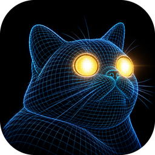

# Tapetum

**3D lighting visualizer for [BlinderKitten](https://github.com/norbertrostaing/BlinderKitten).** Tapetum reads your BlinderKitten show, receives its Art-Net on the same computer and shows the light as it would look on stage: beams in haze, colours, gobos, moving heads, LED cells – on the set you drew in [IngeTrazo](https://github.com/ingelibre/ingetrazo).

Native app written in Rust, for macOS (Apple Silicon and Intel), Windows and Linux (x64 and ARM64 each). German and English.

> **Transparency:** Tapetum was written entirely with AI (“vibe-coded” with Claude by Anthropic) – every line of code, including this README. The logo was generated with ChatGPT. The software is provided “as is”, without warranty of any kind.

Website and downloads: **https://tapetum.org/**

---

## Table of contents

1. [Getting started](#getting-started)
2. [BlinderKitten integration](#blinderkitten-integration)
3. [Stage objects and IngeTrazo](#stage-objects-and-ingetrazo)
4. [Scenes](#scenes)
5. [Fixtures](#fixtures)
6. [Quality levels](#quality-levels)
7. [Navigation, SpaceMouse and shortcuts](#navigation-spacemouse-and-shortcuts)
8. [Files](#files)
9. [Tested versions](#tested-versions)
10. [Development and build](#development-and-build)
11. [Security](#security)
12. [License and credits](#license-and-credits)

---

## Getting started

1. **Download** Tapetum for your system from the [releases](https://github.com/julius-b-mueller/tapetum/releases/latest) and install it.
   - macOS: open the `.dmg` and drag Tapetum to *Applications*. The app is unsigned: on first launch macOS warns; scroll down in *System Settings → Privacy & Security* and click *Open Anyway*.
   - Windows: run the installer (no administrator rights needed) or unpack the portable `.zip`. If SmartScreen warns, click *More info → Run anyway*. Allow incoming UDP on port 6454 in the firewall when asked.
   - Linux: `.AppImage` (make it executable), `.deb` or `.rpm`.
2. **Start Tapetum.** The first time, it opens an **example** – a small theatre with fixtures, cues and a set. Click *Save the example to …* at the top of the sidebar and choose a folder: Tapetum puts `Tapetum-Demo.olga` (the BlinderKitten show), `Tapetum-Demo.igz` (the IngeTrazo set) and its project there. *Show in file manager* takes you to them – open the `.olga` with BlinderKitten and the `.igz` with IngeTrazo and carry on with step 3. Your own show: *☰ → Open another show …*; Tapetum opens the last show by itself next time, *☰ → Open the example* goes back to the example.
3. **Connect BlinderKitten** – the sidebar walks you through it (*Set up BlinderKitten*):
   1. In BlinderKitten: *File → Preferences → OSC Remote Control* → tick *Enabled* (once, for all shows).
   2. Open the same show in BlinderKitten.
   3. Click *Add the Tapetum interfaces in BK*. Tapetum adds an Art-Net interface “Tapetum …” for every DMX interface of the show, with a pass-through from the original one. Patch and hardware stay unchanged; BlinderKitten saves and reloads the show, a backup is left as `.olga.bak`.
   4. Run a cue or set a value in the programmer – the light appears.
4. **Place fixtures:** fixtures without a position in BlinderKitten are lined up automatically. Click one and drag the arrows (move) or rings (turn); Tapetum writes the position back to BlinderKitten – save there to keep it.
5. **Add your set:** *Stage objects → Import …* an IngeTrazo file (`.igz`) or glTF/OBJ/STL.

Without BlinderKitten running, Tapetum still shows the show from the file and keeps edited positions until BlinderKitten is back.

## BlinderKitten integration

- **Show file:** fixtures, fixture types, channels, patch, positions, groups and cuelists come straight from the `.olga`. Changes are picked up as soon as BlinderKitten saves.
- **Art-Net on localhost:** one-click mirror interfaces with pass-through, so the real hardware keeps getting its data.
- **Live remote:** Tapetum talks to BlinderKitten's OSC Remote Control (port 42000): groups appear live, the current cue of the main conductor cuelist is followed, fixture positions and the pan/tilt/zoom *Physical range* are written back.
- **Selection:** a click selects a fixture, a right click its BlinderKitten group (a menu asks if it's in several), Shift/Cmd adds.

## Stage objects and IngeTrazo

- **IngeTrazo (`.igz`) read directly** – no export needed, no connection to IngeTrazo. Every top-level group and component becomes an object of its own; materials and textures are taken over and can be overridden per object (colour, reflectance, opaque or translucent with transmission and diffusion – gauze, glass, opera foil).
- Tapetum **never changes the `.igz`**; when you save in IngeTrazo, the set reloads by itself.
- IngeTrazo's **front view is the audience view** (both look along +Y, Z up), and its face-me people and trees turn towards the camera.
- Without IngeTrazo: glTF/GLB, OBJ (with MTL) and STL, with unit and up axis.
- Beams end at objects and cast shadows; gobos land on every surface, gauze and opera foil included (shadow play from behind on *High*).

## Scenes

The **base scene** is the files as they are. Further scenes move, turn or hide objects (set changes) and can be bound to a cue ID of BlinderKitten's main cuelist: while it runs, the scene with the highest cue ID not above the current cue is shown, with a smooth transition. Otherwise choose the scene by hand.

## Fixtures

Fixture types are recognized from their channels (moving head, spot/PAR, bar, wash, conventional) and can be tuned per type:

- beam type spot/wash, beam angle (up to 360°) or zoom range, lumens, body size, white colour temperature, strobe range
- LED layouts (rectangular or rings) with LED-to-cell assignment; cells as separate lights or one mixed beam
- colour wheel and gobo wheel (built-in patterns incl. moving water, or your own pictures), fixed gobos for fixtures without a gobo channel
- pan/tilt range, speed and acceleration – heads travel instead of jumping

## Quality levels

| | Low – older computers | Medium – standard | High – strong graphics |
|---|---|---|---|
| Beams in haze | simpler, no noise | smooth (TAA) | finer |
| Shadows / beams end at objects | – | main beam of each fixture | every beam and cell |
| Bloom, house light | off, even light | on, ceiling lights | on, ceiling lights |
| 3D resolution (automatic) | ¾ of the screen | screen (half on Retina) | full Retina, up to 4K |

If it runs below 25 fps for a while, Tapetum offers to switch one level down.

## Navigation, SpaceMouse and shortcuts

| | |
|---|---|
| Left drag | orbit |
| Right/middle drag, Shift + left drag | pan |
| Scroll | zoom |
| Gizmo arrows / rings | move (Shift: 10 cm steps) / turn (15° steps, Shift: free) |
| Cmd/Ctrl+Z, Shift+Cmd/Ctrl+Z, Ctrl+Y | undo / redo |
| Tab | hide/show the sidebar |
| F11 | full screen |

A **3Dconnexion SpaceMouse** moves the stage (or the camera, switchable). Its buttons jump to the audience view and the top view, framed to show everything. On macOS Tapetum uses the 3Dconnexion driver; it can keep the SpaceMouse while you operate BlinderKitten. On Linux, `/dev/hidraw*` needs a udev rule for vendor `256f` (and `046d` for older models).

## Files

- `<show>.tapetum` next to the show: everything BlinderKitten doesn't know (fixture settings, objects, scenes, render settings, positions not yet in BlinderKitten). Plain JSON, saved as you go.
- `tapetum-gobos/` next to the show: imported gobo pictures.
- Language and the last show: `~/Library/Application Support/Tapetum` (macOS), `%APPDATA%\Tapetum` (Windows), `~/.config/tapetum` (Linux).

## Tested versions

BlinderKitten **1.0.1b98** and IngeTrazo **0.5.7** (`.igz` file format up to 3). Other versions probably work but haven't been checked.

## Development and build

```sh
cargo run --release -p tapetum -- path/to/show.olga
cargo test --workspace
cargo deny check          # licenses, sources and advisories of all dependencies
```

Linux needs `libudev-dev libx11-dev libxkbcommon-dev libwayland-dev`. The built-in example is made by `python3 scripts/gen-example.py` (into `crates/tapetum/assets/example/`). Packages: `scripts/bundle-macos.sh --dmg [--x64]`, `scripts/bundle-appimage.sh`, `scripts/windows-installer.nsi`; the GitHub workflow builds all of them for a version tag (`0.2.0`). After changing dependencies, `python3 scripts/gen-licenses.py` updates the license list shown in the app.

Crates: `bk-olga` (show file and BlinderKitten's naming), `bk-artnet` (receiver), `tapetum-project` (project file), `tapetum` (the app, Bevy + egui).

Developer commands: `tapetum dump <show>`, `tapetum monitor --show <show>`, `tapetum test-send <show>` (Art-Net test pattern), `tapetum mirror <show> [--remove] [--offline]`.

## Security

Show, project and model files can come from anywhere. Tapetum only reads them: it never runs anything from them, limits the size of every file it reads (including files a model refers to and entries of `.igz` archives) and refuses devices and pipes. It talks to BlinderKitten on `127.0.0.1` only; Art-Net is received on all network interfaces (so BlinderKitten may run on another computer) and only ever changes what you see. Tapetum sends nothing to the internet. Please report vulnerabilities privately to hello@tapetum.org.

## License and credits

Tapetum is free software under the [MIT License](LICENSE). The open source licenses of all libraries are listed in the app (*☰ → About Tapetum*) and in [`crates/tapetum/assets/third-party-licenses.txt`](crates/tapetum/assets/third-party-licenses.txt).

- Code: written with Claude (Anthropic), directed by Julius B. Müller.
- Logo: generated with ChatGPT.
- Pergola bench and figure (in the built-in example and the tests): IngeTrazo model `banca-pergola-yanque.igz` by Marco Sumari Tellez, CC BY 4.0 (see `crates/tapetum/tests/data/README.md`). The theatre around it is modelled in `scripts/gen-example.py`.
- Thanks to the authors of BlinderKitten, IngeTrazo, Bevy, egui and every library Tapetum uses.
